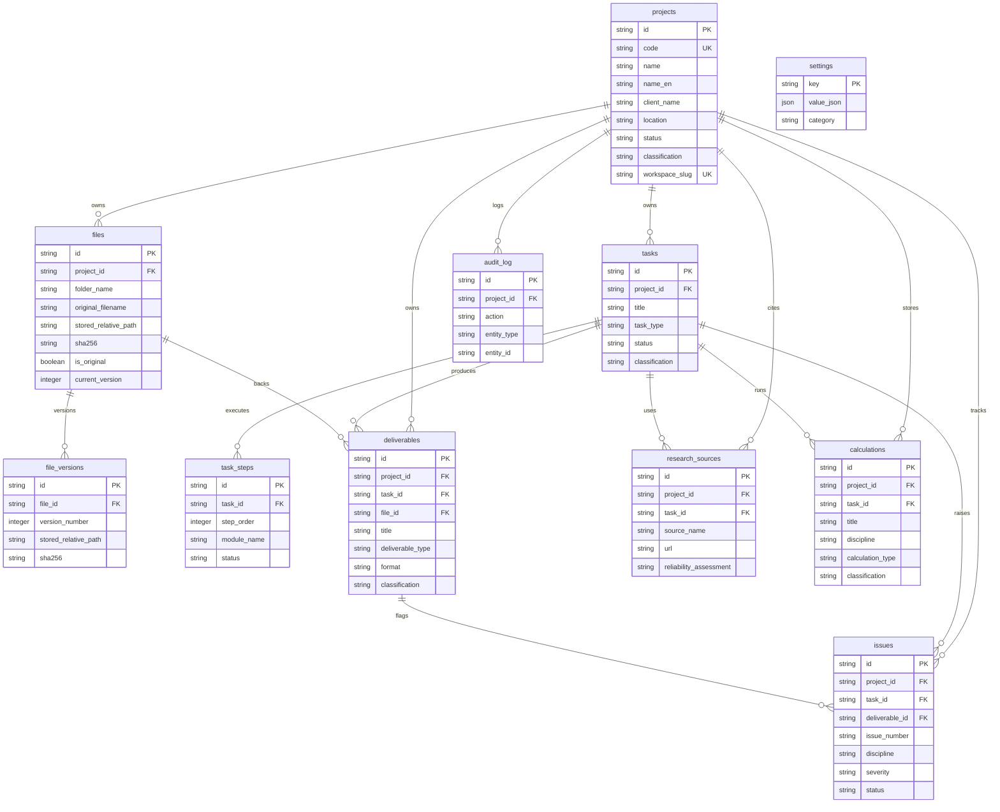

# Step 02 — Database and project workspaces

Date: 2026-11-18
Status: COMPLETE
Classification: Preliminary

## 1. Scope done
- **Configured SQLite + PostgreSQL-ready database settings (`backend/app/core/config.py`, `.env.example`):**
  - Re-added `DATABASE_URL=` to `.env.example` (left blank by default).
  - Updated `Settings.resolve_database_url()` so a blank `DATABASE_URL` defaults to `sqlite:///<WORKSPACES_DIR>/engineering_agent.db`, relative `sqlite:///` paths resolve against `REPO_ROOT` rather than the process working directory, and `:memory:` or PostgreSQL URLs (`postgresql://...`, `postgresql+psycopg://...`) pass through unmodified.
- **Built SQLAlchemy 2.0 ORM schema with all 11 planned tables (`backend/app/db/base.py`, `backend/app/db/models.py`, `backend/app/db/session.py`):**
  - Created tables `projects`, `files`, `file_versions`, `tasks`, `task_steps`, `deliverables`, `research_sources`, `issues`, `calculations`, `settings`, and `audit_log` with explicit `MetaData` naming conventions, foreign keys (`CASCADE` / `SET NULL`), unique constraints, UTC timestamps, and full UTF-8 Arabic/English text storage.
  - Configured SQLite per-connection `PRAGMA foreign_keys=ON` and `PRAGMA busy_timeout=5000`, with automatic parent directory creation for file-backed SQLite databases.
- **Initialized Alembic migrations (`backend/alembic.ini`, `backend/alembic/env.py`, `backend/alembic/script.py.mako`, `backend/alembic/versions/0001_initial_schema.py`, `backend/app/db/migrations.py`):**
  - Generated initial migration revision `0001` (`initial_schema`) creating all 11 tables and indexes with matching `downgrade()` support and `render_as_batch=True` for SQLite.
  - Integrated `upgrade_database(settings.database_url)` into FastAPI lifespan startup (`backend/app/main.py`) with clean `engine.dispose()` on shutdown.
- **Implemented 12-folder project workspace service & REST API (`backend/app/services/workspace.py`, `backend/app/services/projects.py`, `backend/app/schemas/projects.py`, `backend/app/api/projects.py`):**
  - Auto-creates all 12 numbered folders per project (`01_Input_Documents` .. `12_Revision_History`) inside `<WORKSPACES_DIR>/<sanitized_stem>_<short_id>`, preserving Arabic project names safely on Windows NTFS while stripping Windows-forbidden characters, avoiding reserved device names, preventing path traversal, and rolling back the directory if DB persistence fails.
  - Exposed `POST /api/projects`, `GET /api/projects`, and `GET /api/projects/{project_id}`, recording `project.created` in `audit_log` and inspecting real on-disk existence of the 12 folders when opening a project.
- **Built minimal RTL-aware UI (`frontend/src/types.ts`, `frontend/src/api.ts`, `frontend/src/components/ProjectWorkspaceView.tsx`, `frontend/src/App.tsx`, `frontend/src/index.css`):**
  - Preserved Arabic (`dir="rtl"`) / English (`dir="ltr"`) toggle and live `/api/health` bar.
  - Added Create Project form (Arabic/English project name, optional code, English title, client, location, description, classification defaulting to `Preliminary`), Persisted Projects list with Refresh button, and Open Project detail page displaying project metadata and live on-disk status for all 12 workspace folders.

### Package versions added

| Package | Version | License | Notes |
|---|---|---|---|
| `SQLAlchemy` (`sqlalchemy`) | `2.1.9` | MIT | Pinned in `backend/requirements.txt` |
| `Alembic` (`alembic`) | `1.20.1` | MIT | Pinned in `backend/requirements.txt` (with transitive `Mako 1.4.3`, `MarkupSafe 3.0.4`) |

### Database schema diagram & table list



| # | Table | Primary Key | Foreign Keys / Key Constraints | Purpose |
|---|---|---|---|---|
| 1 | `projects` | `id` (`String(36)`) | Unique: `code`, `workspace_slug` | Engineering projects & workspace slug mapping |
| 2 | `files` | `id` (`String(36)`) | `project_id -> projects.id` (`CASCADE`) | Registered input, original, and generated project files (Step 03+) |
| 3 | `file_versions` | `id` (`String(36)`) | `file_id -> files.id` (`CASCADE`), Unique `(file_id, version_number)` | Immutable version snapshots and SHA-256 checksums |
| 4 | `tasks` | `id` (`String(36)`) | `project_id -> projects.id` (`CASCADE`) | Natural-language engineering assignments and statuses (Step 05+) |
| 5 | `task_steps` | `id` (`String(36)`) | `task_id -> tasks.id` (`CASCADE`), Unique `(task_id, step_order)` | Orchestrator/skill execution trace steps |
| 6 | `deliverables` | `id` (`String(36)`) | `project_id -> projects.id` (`CASCADE`), `task_id -> tasks.id` (`SET NULL`), `file_id -> files.id` (`SET NULL`) | Generated consultancy outputs with classification & version |
| 7 | `research_sources` | `id` (`String(36)`) | `project_id -> projects.id` (`CASCADE`), `task_id -> tasks.id` (`SET NULL`) | Cited web/standard/catalogue sources & reliability notes |
| 8 | `issues` | `id` (`String(36)`) | `project_id -> projects.id` (`CASCADE`), `task_id -> tasks.id` (`SET NULL`), `deliverable_id -> deliverables.id` (`SET NULL`), Unique `(project_id, issue_number)` | Multi-agent QA findings & corrective-action register |
| 9 | `calculations` | `id` (`String(36)`) | `project_id -> projects.id` (`CASCADE`), `task_id -> tasks.id` (`SET NULL`) | Structured inputs, units, equations, methodology, and results |
| 10 | `settings` | `key` (`String(128)`) | PK on `key` | Non-secret application configuration (keys remain in `keyring`) |
| 11 | `audit_log` | `id` (`String(36)`) | `project_id -> projects.id` (`SET NULL`) | Append-only audit log for project/file/system events |

## 2. Files created/changed
- `.env.example` (re-added blank `DATABASE_URL=` with path/PostgreSQL documentation)
- `backend/requirements.txt` (pinned `sqlalchemy==2.1.9`, `alembic==1.20.1`)
- `backend/app/core/config.py` (added `database_url` setting + `resolve_database_url` validator)
- `backend/app/main.py` (added DB engine/session lifecycle + Alembic startup migration + `/api/projects` router)
- `backend/app/db/{__init__.py,base.py,models.py,session.py,migrations.py}`
- `backend/alembic.ini`, `backend/alembic/{env.py,script.py.mako}`, `backend/alembic/versions/0001_initial_schema.py`
- `backend/app/schemas/projects.py`
- `backend/app/services/{workspace.py,projects.py}`
- `backend/app/api/projects.py`
- `backend/tests/{test_config.py,test_migrations.py,test_projects.py}`
- `frontend/src/{types.ts,api.ts,App.tsx,App.test.tsx,index.css}`, `frontend/src/components/ProjectWorkspaceView.tsx`
- `docs/DECISIONS.md` (`ADR-008`), `docs/reports/step-02.md`

*(Did not modify `.github/` or `CLAUDE.md`.)*

## 3. Tests run (pre-commit verification on final code)

### A. Python packages (`pip show sqlalchemy alembic`)
```text
Name: SQLAlchemy
Version: 2.1.9
Summary: Database Abstraction Library
Home-page: https://www.sqlalchemy.org
Author: 
Author-email: Mike Bayer <mike_mp@zzzcomputing.com>
License-Expression: MIT
Location: <repo>\backend\.venv\Lib\site-packages
Requires: typing-extensions
Required-by: alembic
---
Name: alembic
Version: 1.20.1
Summary: A database migration tool for SQLAlchemy.
Home-page: https://alembic.sqlalchemy.org
Author: 
Author-email: Mike Bayer <mike_mp@zzzcomputing.com>
License-Expression: MIT
Location: <repo>\backend\.venv\Lib\site-packages
Requires: Mako, SQLAlchemy, typing-extensions
Required-by: 
```

### B. Backend test suite (`pytest -v` in `backend/`)
```text
============================= test session starts =============================
platform win32 -- Python 3.12.10, pytest-8.4.2, pluggy-1.7.0 -- <repo>\backend\.venv\Scripts\python.exe
cachedir: .pytest_cache
rootdir: <repo>\backend
configfile: pytest.ini
testpaths: tests
plugins: anyio-4.16.0
collecting ... collected 10 items

tests/test_config.py::test_blank_workspaces_dir_defaults_to_repo_root PASSED [ 10%]
tests/test_config.py::test_relative_workspaces_dir_resolves_against_repo_root PASSED [ 20%]
tests/test_config.py::test_blank_database_url_defaults_inside_workspaces_dir PASSED [ 30%]
tests/test_config.py::test_relative_sqlite_database_url_resolves_against_repo_root PASSED [ 40%]
tests/test_config.py::test_postgresql_and_memory_database_urls_pass_through PASSED [ 50%]
tests/test_health.py::test_api_health_returns_ok PASSED                  [ 60%]
tests/test_migrations.py::test_alembic_upgrade_and_downgrade_round_trip PASSED [ 70%]
tests/test_projects.py::test_arabic_project_creation_folders_and_restart_persistence PASSED [ 80%]
tests/test_projects.py::test_duplicate_code_returns_409_without_orphaned_folder PASSED [ 90%]
tests/test_projects.py::test_validation_not_found_and_path_safety PASSED [100%]

============================= 10 passed in 1.88s ==============================
```

### C. Frontend unit tests & TypeScript/Vite build (`npm.cmd test` + `npm.cmd run build` in `frontend/`)
```text
> ai-engineering-agent-frontend@0.1.0 test
> vitest run

 RUN  v2.1.9 <repo>/frontend

 ✓ src/App.test.tsx (4 tests) 13ms

 Test Files  1 passed (1)
      Tests  4 passed (4)
   Duration  384ms

> ai-engineering-agent-frontend@0.1.0 build
> tsc --noEmit && vite build

vite v6.4.6 building for production...
transforming...
✓ 29 modules transformed.
rendering chunks...
computing gzip size...
dist/index.html                   0.48 kB │ gzip:  0.33 kB
dist/assets/index-BlTeey_V.css    3.58 kB │ gzip:  1.13 kB
dist/assets/index-Dkrvvfib.js   156.17 kB │ gzip: 50.08 kB
✓ built in 469ms
```

### D. Live multi-process backend restart + Vite proxy verification
Verified against an isolated temporary workspace under `workspaces/_step02_live_smoke` (cleaned up afterwards):
- Process #1 (`uvicorn app.main:app` on `127.0.0.1:8000`) -> `GET /api/health` (`ok Preliminary`) -> `POST /api/projects` with `{"name": "مستشفى طرابلس التعليمي", "client_name": "وزارة الصحة"}`:
  `CREATED_ARABIC_PROJECT: 83c07c00-7f19-4fca-8489-22f9e632c2cc PRJ-20261118-83C07C مستشفى_طرابلس_التعليمي_83c07c00 12 True`
- Killed Process #1 cleanly, launched Process #2 (`uvicorn`) + Vite (`127.0.0.1:5173`):
  - `FRONTEND_RTL_OK: True` (`lang="ar" dir="rtl"`)
  - `RESTART_LIST_PROXY: 1 True` (`GET http://127.0.0.1:5173/api/projects` returns persisted Arabic project)
  - `RESTART_OPEN_PROXY: True 12 True` (`GET http://127.0.0.1:5173/api/projects/{id}` verifies workspace root and all 12 numbered folders on disk)
  - `ALEMBIC_CURRENT: 0001 (head)`

*(Final-head `pytest`, `vitest`, `build`, `node --test`, and `gitleaks` outputs at the final committed SHA are recorded in the Pull Request description and PR verification output.)*

## 4. Acceptance tests
1. **Create project with Arabic name -> 12 folders exist on disk:** **PASS** — Verified both in `test_arabic_project_creation_folders_and_restart_persistence` (`pytest`) and live HTTP test against Windows NTFS (`مستشفى_طرابلس_التعليمي_<id>` containing `01_Input_Documents` .. `12_Revision_History`, `12/12` present).
2. **Restart app -> project still there:** **PASS** — Verified across both two separate `create_app()` FastAPI instances in `pytest` and two separate OS `uvicorn` processes queried through Vite proxy (`RESTART_LIST_PROXY: 1 True`, `RESTART_OPEN_PROXY: True 12 True`).
3. **DB schema & Alembic migration (all 11 tables):** **PASS** — Verified `upgrade_database("head")`, `downgrade_database("base")`, and re-`upgrade_database("head")` in `test_migrations.py`, plus `PRAGMA foreign_keys=ON`.
4. **Minimal RTL-aware UI & API client:** **PASS** — Verified Arabic RTL (`dir="rtl"`) / English LTR (`dir="ltr"`) project creation form, project list, 12-folder project detail page, and real API error propagation in `src/App.test.tsx`.

## 5. Decisions made (also in `docs/DECISIONS.md`)
- **ADR-008:** Use synchronous SQLAlchemy `2.1.9` + Alembic `1.20.1` with SQLite foreign keys enabled, default `DATABASE_URL` inside `<WORKSPACES_DIR>/engineering_agent.db` (PostgreSQL-ready via env override), automatic Alembic upgrade during FastAPI lifespan startup, and Unicode-preserving NTFS folder naming (`<sanitized_stem>_<short_id>`) with transactional rollback cleanup on DB errors.

## 6. Deviations from the plan and why
- **Workspace slug format `<sanitized_stem>_<short_id>`:** Instead of using only an opaque ID or raw unsanitized Arabic title as the folder name, `<sanitized_stem>_<short_id>` keeps the Arabic project name readable in Windows Explorer while preventing reserved-name (`CON`/`NUL`), forbidden-character, `MAX_PATH`, and duplicate-name collisions.
- **Automatic Alembic upgrade in FastAPI lifespan:** Running `upgrade_database` idempotently during backend startup ensures `scripts/start.bat` works out of the box without requiring users to invoke `alembic upgrade head` manually beforehand.

## 7. Known limitations / things not verified
- **PostgreSQL runtime execution:** Schema types, metadata naming conventions, and `Settings.resolve_database_url` passthrough are PostgreSQL-ready and unit-tested at config level, while end-to-end DB runtime tests executed against SQLite (no live PostgreSQL server was provisioned locally).
- **Step 03+ workflows out of scope:** File upload/SHA-256 registration, project archival/deletion UI, and task execution endpoints belong to Step 03+ and are intentionally not implemented in Step 02.
- **External tools for future steps:** Tesseract OCR (`ara+eng`, Step 06) and ODA File Converter (Step 07) remain `not installed - pending owner` (documented in `docs/reports/step-01.md`).

## 8. Questions or items needing the owner
- Start the app with `scripts\start.bat`, create an Arabic project (e.g., `مستشفى طرابلس التعليمي`) in the browser at `http://127.0.0.1:5173`, confirm all 12 numbered folders under `workspaces\` on disk, restart the server, and confirm the project persists cleanly.
- Review and merge this Step 02 PR yourself and reply `PASS step 02` before I begin Step 03.

## 9. How the owner can see/try it
1. Check out the PR branch or pull `main` after merging:
   ```powershell
   scripts\start.bat
   ```
2. Open `http://127.0.0.1:5173`, enter an Arabic project name (such as `مستشفى طرابلس التعليمي`), and submit.
3. Confirm the opened project page shows all 12 folders (`موجود على القرص`) and check `<repo>\workspaces\` in File Explorer.
4. Close the two server windows, re-run `scripts\start.bat`, refresh `http://127.0.0.1:5173`, and confirm the project loads from SQLite.
5. Run automated checks manually:
   - `cd backend && .\.venv\Scripts\python.exe -m pytest -v`
   - `cd frontend && npm.cmd test && npm.cmd run build`
   - `node --test tests/test_utf8_encoding.mjs tests/test_no_local_paths.mjs`

## 10. Ready for next step?
**Yes** — Ready for owner review, merge, and `PASS step 02` to proceed to Step 03.
